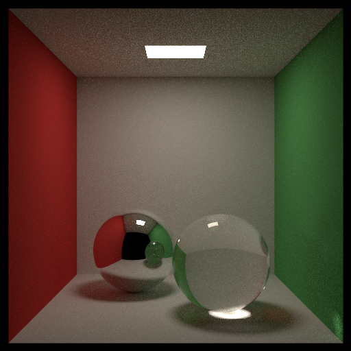
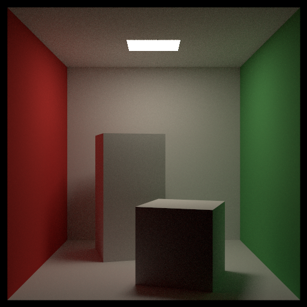
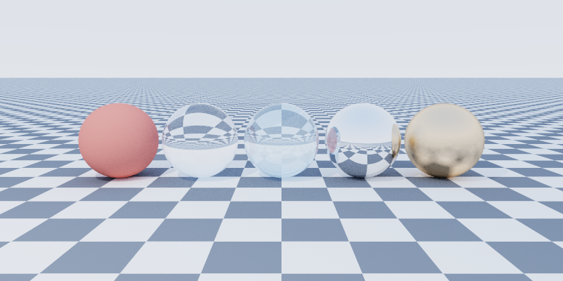
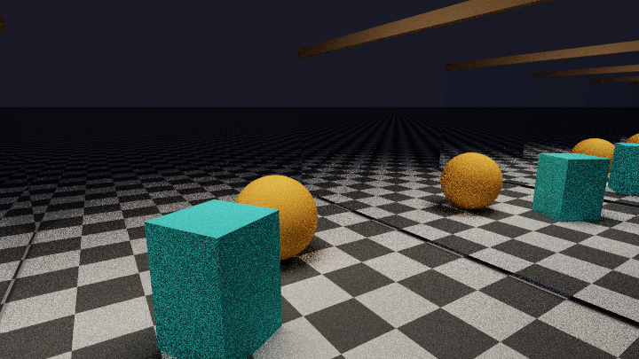
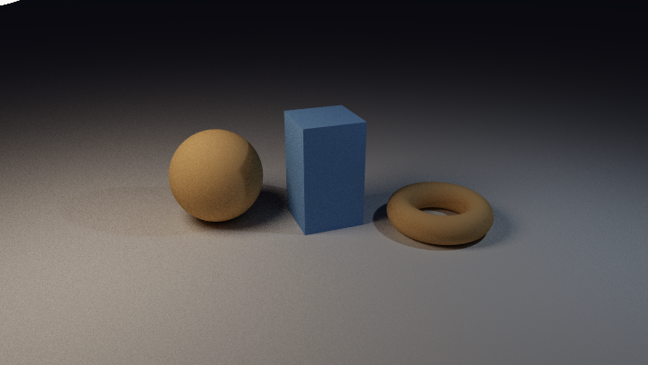
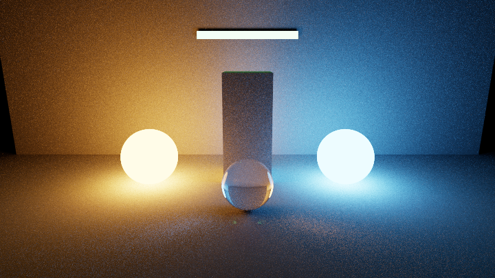
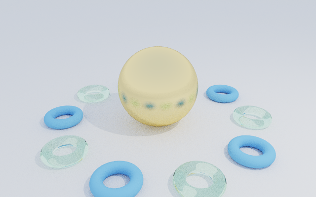
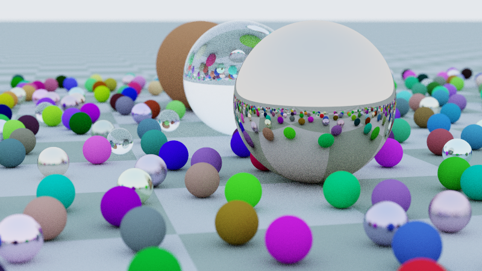
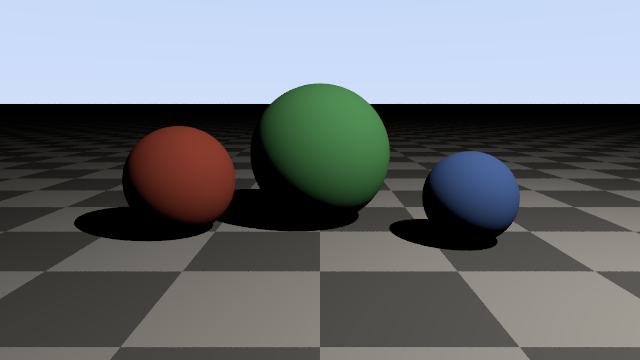
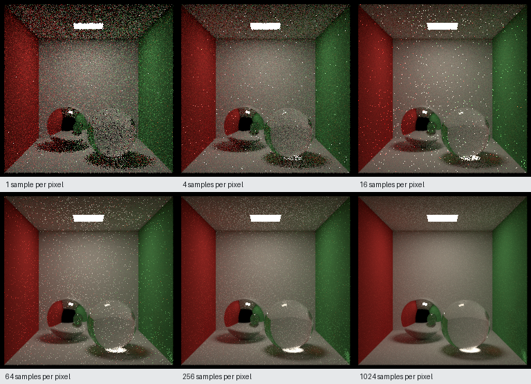

# raytracer

A physically based path tracer written from scratch in C++20, with a browser scene editor that drives it.

**Live demo: <https://kaushlendra-kumar.github.io/ray-tracer/>**: the same C++ renderer, compiled to WebAssembly, running multithreaded in your browser. No server is involved.

[](https://github.com/Kaushlendra-Kumar/ray-tracer/actions/workflows/ci.yml)

The rendering core implements its own intersection, sampling, shading, acceleration and scheduling code; it depends only on the C++ standard library (plus a vendored single-header PNG encoder). The browser editor never renders anything in JavaScript: it edits a JSON scene description and hands it to the C++ renderer, either compiled to WebAssembly and running in a Web Worker (the default, and what the live demo uses), or as a native binary driven by a small Go server that streams its progressive frames back.



*512×512, 1024 samples per pixel, rendered by this engine in 123 s on two cores.*

## What it does

- **Geometry:** spheres, infinite planes, triangles, quads, boxes, triangle meshes (procedural icospheres and tori, or Wavefront OBJ files) with smooth vertex normals.
- **Materials:** Lambertian diffuse (optionally checkered), metal with roughness, dielectrics with Fresnel (Schlick) and total internal reflection, one-sided or two-sided area emitters.
- **Lights:** point lights (hard shadows) and any emissive sphere or triangle (soft shadows).
- **Integrators:** unbiased Monte Carlo path tracing with next-event estimation and Russian roulette; a Whitted-style direct-lighting integrator; a normals debug view.
- **Camera:** perspective with configurable field of view, thin-lens depth of field.
- **Acceleration:** binned-SAH bounding volume hierarchy, verified against brute force.
- **Rendering:** tile-based multithreading, progressive passes, clean cancellation, deterministic output for a fixed seed regardless of thread count, ACES/Reinhard tone mapping and exact sRGB encoding, PNG and PPM output.
- **Editor:** orbit/pan/zoom camera with live low-resolution previews, object hierarchy, material and light editing, render settings, JSON import/export, saving scenes in the browser, PNG download.
- **WebAssembly:** the unchanged core built with Emscripten. On a cross-origin isolated page it uses pthreads (one per core) through the same tile scheduler, and the image is bit-identical to the single-threaded fallback build.

## Gallery

Every image below was produced by this renderer from the scene file named under it (`tools/render_gallery.sh` regenerates all of them). Times are wall-clock on a 2-core 2.1 GHz Xeon VM.

| | |
|---|---|
|  `cornell_box.json` — indirect light and colour bleeding, 256 spp, 45 s |  `materials.json` — diffuse, glass (IOR 1.5 and 2.4), mirror, rough metal, 256 spp, 10 s |
|  `mirrors.json` — facing mirrors, 40-bounce specular paths, 10 s |  `soft_shadows.json` — a large and a tiny spherical light, 25 s |
|  `emissive_glow.json` — only emissive objects light the room, 45 s |  `mesh_bvh.json` — 174 k triangles through the BVH, 17 s |
|  `sphere_field.json` — ~480 spheres, depth of field, 12 s |  `first_light.json` — the first milestone: direct light and hard shadows, 0.3 s |

Progressive convergence of the glass-and-metal Cornell box (each pass doubles the sample count):



The remaining speckles at 1024 spp are caustic paths (light → glass → diffuse surface), which a path tracer can only find by chance; see [rendering_pipeline.md](docs/rendering_pipeline.md#known-limitations).

## Build and run

Prerequisites: a C++20 compiler (GCC 11+ or Clang 14+), CMake 3.20+, optionally Ninja. Tested here with GCC 13.3 and CMake 3.28 on Linux. The editor additionally needs Go 1.22+ and Node 18+.

```sh
cmake -S . -B build -G Ninja          # Release by default
cmake --build build
```

Render a scene:

```sh
./build/rt assets/scenes/cornell_box.json -o cornell.png
./build/rt assets/scenes/materials.json -o quick.png --width 400 --height 200 --spp 32
./build/rt assets/scenes/first_light.json -o first.ppm          # PPM output
./build/rt assets/scenes/mesh_bvh.json -o ref.png --no-bvh      # brute-force reference (slow)
./build/rt --help                                                 # all options
```

Useful flags: `--spp`, `--max-depth`, `--threads` (0 = all cores), `--integrator path|direct|normals`, `--seed`, `--no-light-sampling`, `--snapshot-dir DIR` (save every progressive pass), `--validate`, `--dump-scene`. Ctrl-C stops a render cleanly and still writes the image so far.

Tests and benchmarks:

```sh
cd build && ctest --output-on-failure     # unit + integration tests (also: ./build/rt_tests)
./build/bench_bvh 6                       # BVH vs brute force on growing meshes
./build/bench_threads ../assets/scenes/sphere_field.json 8
```

Sanitizer builds:

```sh
cmake -S . -B build-asan -DCMAKE_BUILD_TYPE=Debug -DRT_SANITIZE=ON && cmake --build build-asan && ./build-asan/rt_tests
cmake -S . -B build-tsan -DRT_TSAN=ON && cmake --build build-tsan && ./build-tsan/rt_tests "[threads],[render]"
```

### Scene editor in the browser (WebAssembly, no server)

Needs the [Emscripten SDK](https://emscripten.org/docs/getting_started/downloads.html) (tested with 6.0.13), CMake and Ninja.

```sh
source /path/to/emsdk/emsdk_env.sh
tools/build_wasm.sh                 # -> web/frontend/public/wasm/rt-{mt,st}.{mjs,wasm}
node tools/wasm_smoke.mjs           # renders a scene with both builds in Node and compares them
cd web/frontend && npm install && npm run dev
```

`npm run build` produces a static site in `web/frontend/dist` that can be hosted anywhere. The threaded build needs the page to be cross-origin isolated: the Vite dev server sends the COOP/COEP headers itself, and on hosts that cannot (GitHub Pages) `public/coi-sw.js`, a small service worker, adds them. Without isolation the editor falls back to the single-threaded build.

### Deployment

`.github/workflows/ci.yml` builds and tests everything on each push (native build + `ctest`, Go tests against the native binary, the WebAssembly build + smoke test, frontend tests) and then publishes `web/frontend/dist` to GitHub Pages. Hosting is free and needs no server.

### Scene editor with the native renderer (Go backend)

```sh
cmake --build build                         # the editor runs build/rt
cd web/frontend && npm install && npm run build
cd ../backend && go run .                   # serves the editor on http://127.0.0.1:8080
```

For frontend development with hot reload, run `go run .` in `web/backend` and `npm run dev` in `web/frontend` (Vite proxies `/api` to the backend), then open the URL Vite prints with `?engine=server` appended (otherwise the editor uses the WebAssembly engine).

In the editor: drag in the viewport to orbit, shift-drag (or right-drag) to pan, scroll to zoom. While you drag, quick low-resolution previews are rendered; when you let go, a full progressive render starts. Edits re-render automatically unless you untick *Re-render on edit*.

Frontend tests: `npm test` in `web/frontend`. Backend tests: `go test ./...` in `web/backend` (integration tests use `build/rt` and are skipped if it has not been built).

## Scene files

Scenes are JSON; see any file in [`assets/scenes`](assets/scenes). A minimal one:

```json
{
  "camera": { "look_from": [0, 1, 4], "look_at": [0, 0.5, 0], "vfov": 40 },
  "render": { "width": 640, "height": 360, "spp": 64 },
  "materials": {
    "floor": { "type": "lambertian", "albedo": [0.8, 0.8, 0.8] },
    "glass": { "type": "dielectric", "ior": 1.5 },
    "lamp":  { "type": "emissive", "color": [1, 0.9, 0.8], "intensity": 8 }
  },
  "objects": [
    { "type": "plane",  "point": [0, 0, 0], "normal": [0, 1, 0], "material": "floor" },
    { "type": "sphere", "center": [0, 0.5, 0], "radius": 0.5, "material": "glass" },
    { "type": "sphere", "center": [2, 3, 1], "radius": 0.5, "material": "lamp" }
  ]
}
```

Object types: `sphere`, `plane`, `triangle`, `quad` (corner + edges `u`, `v`; lit side faces `u × v`), `box` (`min`, `max`, `rotate_y`), `mesh` (`source`: `icosphere` | `torus` | `obj`, plus `scale`, `rotate_y`, `translate`). Lights: `{"type": "point", "position": [...], "intensity": [...]}`. Every field is validated, and errors name the field: `objects[2].radius: must be > 0`.

## Documentation

- [docs/architecture.md](docs/architecture.md) — modules, data flow, ownership and threading model.
- [docs/math_foundations.md](docs/math_foundations.md) — conventions, vectors, intersections, optics, numerical tolerances.
- [docs/rendering_pipeline.md](docs/rendering_pipeline.md) — materials, Monte Carlo estimators, light sampling, Russian roulette, BVH, tone mapping, limitations.
- [docs/performance.md](docs/performance.md) — profiling results, benchmarks, what was and was not optimised.
- [docs/development_log.md](docs/development_log.md) — milestone-by-milestone record, including the bugs the tests caught.

## Status

All roadmap phases are implemented. Known limitations, documented in detail in the docs:

- No multiple importance sampling, so small bright lights seen through glass (caustics) converge slowly.
- Rough metal uses a sampled-only "fuzzy reflection" model rather than a microfacet BRDF.
- No textures beyond a procedural checkerboard; OBJ loading ignores materials and UVs.
- No handwritten SIMD: profiling with `-march=native` showed no gain, so the scalar code was kept (see performance.md).
- The editor's interaction logic is covered by jsdom tests and the HTTP flow by end-to-end tests. The WebAssembly engine is covered by a Node smoke test (both builds, cancellation, bit-identical output).
- In the browser, OBJ meshes cannot be loaded (there is no file system); procedural meshes work.

## License

MIT (see [LICENSE](LICENSE)). Vendored: Catch2 (BSL-1.0) and stb_image_write (public domain / MIT).
